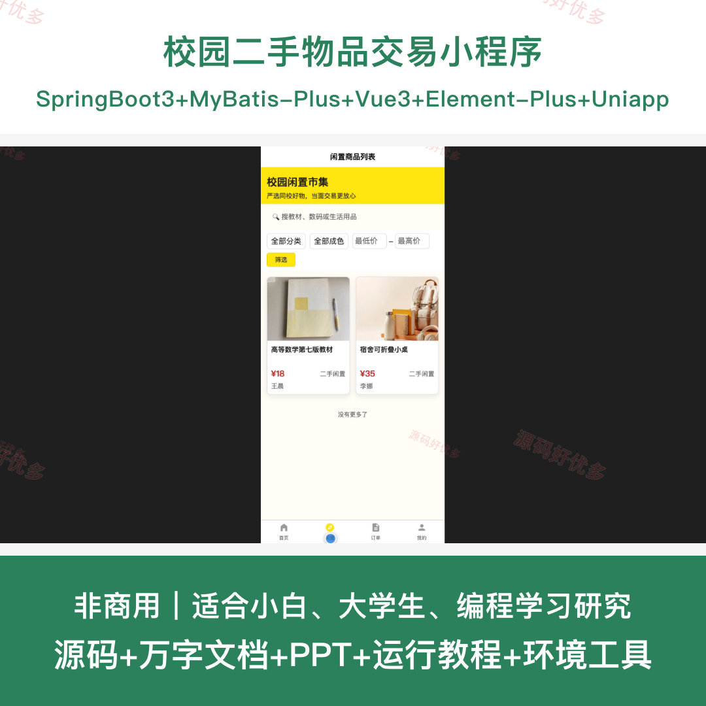
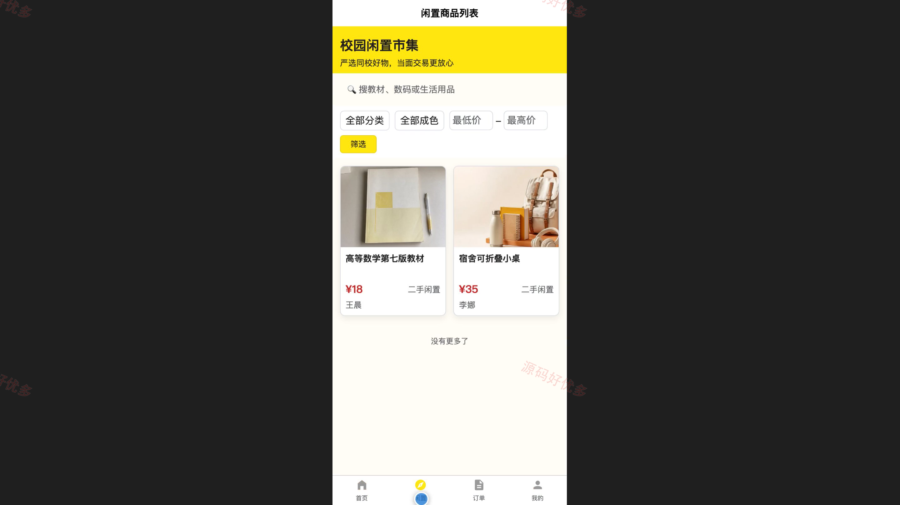
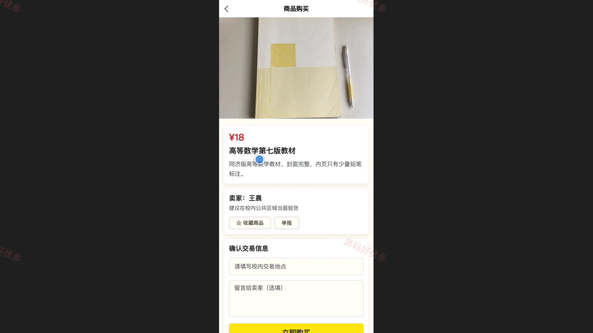
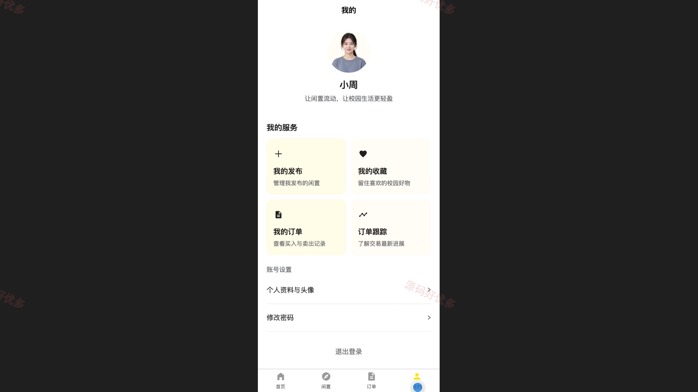
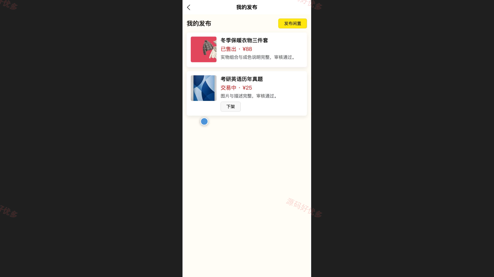
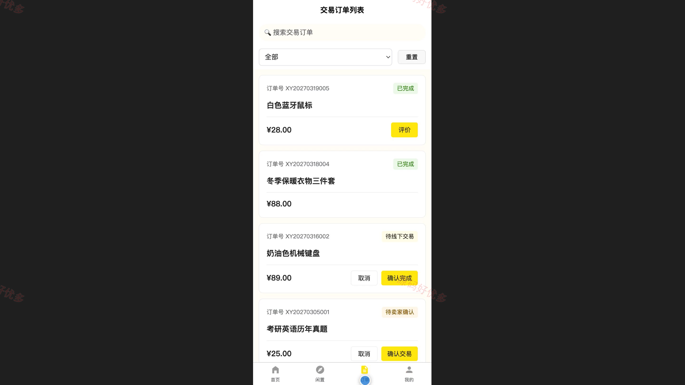
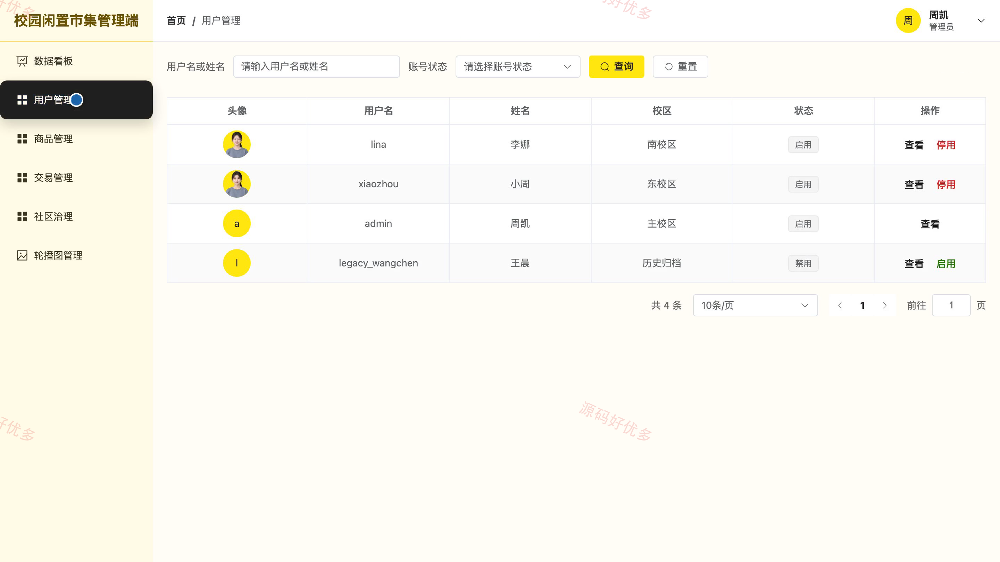
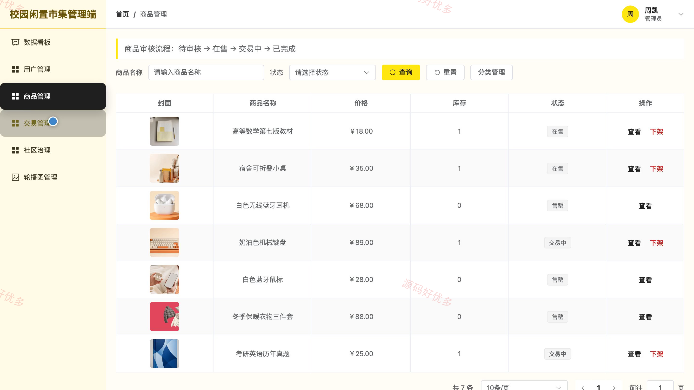
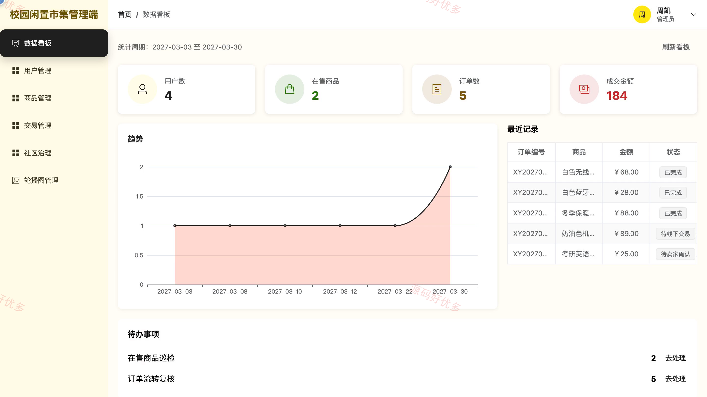

# bs001B
bs001B校园二手物品交易小程序源码 Java SpringBoot3 Vue3 文档 PPT
## 源码问题查看主页咨询

### 一、关键词
校园闲置交易、校内二手市场、闲置物品发布、二手商品买卖、线下交易订单

### 二、作品包含
源码+数据库+万字设计文档+PPT+全套环境和工具资源+本地部署教程

### 三、项目技术
前端技术： Html、Css、Js、Vue3.4、Element-Plus、uniapp
后端技术：Java、SpringBoot3.2.0、MyBatis-Plus

### 四、运行环境（以下版本亲测，其他版本兼容性请自行测试）
开发工具：IDEA/eclipse + VSCODE + HBuilder X + 微信开发者工具

数据库：MySQL5.7+（共13张表）

数据库管理工具：Navicat10以上版本

环境配置软件： JDK17 + Maven3.6

前端Nodejs：16+

浏览器：谷歌浏览器

### 五、项目介绍
项目编号：bs001B

本系统面向校内闲置物品流转场景，普通用户可在微信小程序端浏览和检索二手商品、发布闲置、收藏商品、提交购买订单并跟踪交易状态；管理员可在网页后台维护用户、分类与轮播内容，审核商品，处理订单、评价和举报，并通过数据看板掌握平台交易情况。

角色：用户、管理员

用户功能：注册登录、首页浏览与商品检索、商品详情查看与收藏、闲置发布及发布管理、购买下单、买卖订单处理、订单状态跟踪与确认完成、交易评价及账户维护。

管理员功能：后台登录、数据看板、用户启停管理、商品分类与轮播维护、商品审核与违规下架、订单状态与异常处理、评价屏蔽与举报处理、个人资料维护。

### 六、运行截图

